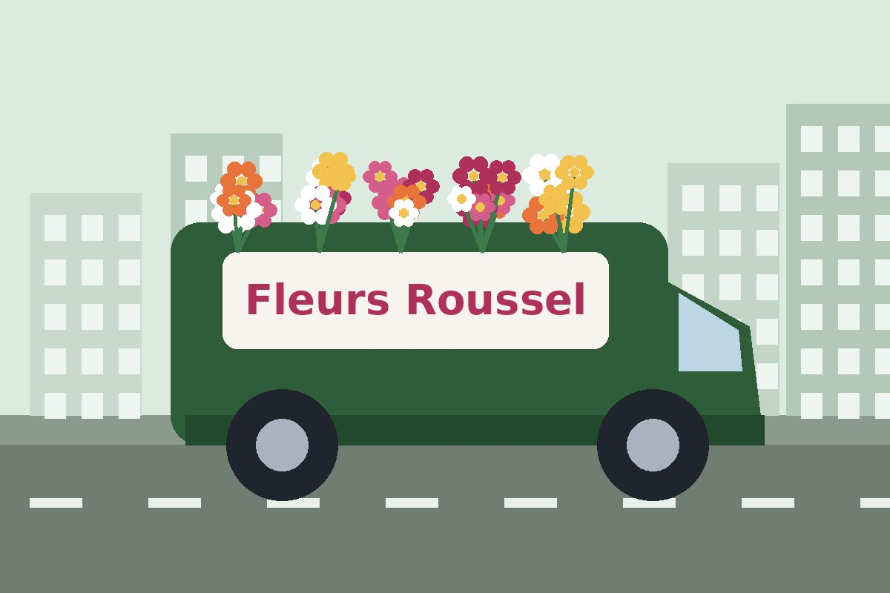

A1 — Problème sur téléphone

Symptôme : La page est trop large sur mon téléphone.

Mon hypothèse : J’ai trouvé une largeur fixe de 960 px dans la classe .conteneur.

Indice reçu de l’IA : À 375 px, le conteneur demande déjà 960 px de largeur. Comment adapter sa largeur à l’écran tout en gardant une largeur maximale ?

Cause : La largeur fixe de 960 px provoquait le débordement. Mon hypothèse était correcte.

Correction : J’ai remplacé width: 960px par width: 100% et ajouté max-width: 960px dans le fichier CSS.

Vérification : J’ai testé la page à 375 px. Le défilement horizontal a disparu.

A2 — Image déformée

Symptôme : L’image du camion est déformée sur les écrans de 375 px et 1280 px.

Mon hypothèse : Je pense que la hauteur fixe de 220 px déforme l’image

Indice reçu de l’IA : Je dois comparer width et height et vérifier quelle règle CSS définit la hauteur de l’image.

Cause : La hauteur fixe de 220 px déformait l’image. Mon hypothèse était correcte.

Correction : J’ai supprimé height: 220px dans la règle .bandeau__photo du fichier CSS.

Vérification : J’ai testé l’image à 375 px et 1280 px. Elle garde ses proportions.

A3 — Indicateur de focus au clavier

Symptôme : Le repère visuel du focus n’est pas visible quand je navigue avec la touche Tab.

Mon hypothèse : Je pense qu’il faut ajouter un effet visuel quand un élément est sélectionné avec la touche Tab.

Indice reçu de l’IA : Je dois chercher la différence entre :hover et la pseudo-classe qui détecte le focus au clavier, puis trouver comment rendre ce focus visible.

Cause : La règle outline: none; empêchait l’affichage du focus.

Correction : J’ai commenté outline: none; dans le fichier CSS.

Vérification : J’ai testé avec la touche Tab et le repère du focus est devenu visible.

A4 — Label Code postal

Symptôme : Le label « Code postal » ne fonctionne pas correctement quand je clique dessus.

Mon hypothèse : Je pense qu’il y a un problème dans le lien entre le label et le champ de saisie.

Indice reçu de l’IA : Je dois vérifier si l’attribut for du label correspond à l’attribut id du champ.

Cause : L’attribut for était différent de l’attribut id.

Correction : J’ai remplacé for="cp" par for="code-postal" dans le fichier HTML.

Vérification : J’ai cliqué sur le label « Code postal » et le focus est passé au champ correspondant.

A5 — Contraste des couleurs

Symptôme : Le texte du caption du tableau et la phrase « Livraison offerte dès 60 € d'achat en zone 1 » sont trop clairs.

Mon hypothèse : Je pense que la règle CSS .note est responsable de la couleur trop claire du texte.

Indice reçu de l’IA : Je dois vérifier la couleur du texte et celle du fond avec un outil de contraste, pour savoir si le rapport atteint 4,5:1.

Cause : La couleur #b4b9b5 est trop claire sur un fond blanc. Le contraste est de 1,97:1 au lieu de 4,5:1 minimum.

Correction : J’ai remplacé var(--gris-texte) par var(--texte) dans les règles .note et .tarifs caption du fichier CSS.

Vérification : J’ai vérifié les deux textes. Le contraste avec le fond blanc est de 15,72:1, donc supérieur au minimum de 4,5:1.

A6 — Texte en italique dans le pied de page

Symptôme : Toutes les informations du pied de page sont en italique.

Mon hypothèse : Je pense qu’une balise HTML <em> est mal placée ou n’est pas fermée correctement.

Indice reçu de l’IA : Je dois vérifier que les balises <em> entourent seulement le nom « Fleurs Roussel ».

Cause : Une balise <em> était placée en trop. Mon hypothèse était correcte.

Correction : J’ai supprimé la balise <em> en trop dans le fichier HTML.

Vérification : J’ai vérifié le pied de page. Seul le nom Fleurs Roussel est en italique.

°°°°°°°°°°°°°°°°°°°°°°°°°°°°°°°°°°°°°°°°°°°°

validateurs HTML :

Error: An img element must have an alt attribute, except under certain conditions. For details, consult guidance on providing text alternatives for images.

From line 34, column 9; to line 34, column 88

    

Après la correction :

Document checking completed. No errors or warnings to show.

Validateur CSS :

Congratulations! No Error Found.

-Relecture par Copilot :

Suggestion 1 — Acceptée

Raison : La phrase parle de toutes les zones, mais la zone 3 est livrée le lendemain. Je pense qu’il faut préciser cette information pour ne pas tromper le client.

Suggestion 2 — Acceptée

Raison : Le formulaire ne vérifie pas vraiment la zone de livraison. Le bouton « Vérifier » ne donne donc pas le résultat attendu.

Suggestion 3 — Acceptée

Raison : La bordure est trop claire sur le fond blanc. Il est difficile de voir les champs du formulaire.

Suggestion 4 — Acceptée

Raison : Le tableau peut défiler horizontalement, mais on ne peut pas accéder facilement à son conteneur avec le clavier.

Suggestion 5 — Acceptée

Raison : La réduction des animations désactive la transition, mais la carte bouge encore quand on passe la souris dessus.

Suggestion 6 — Rejetée

Raison : Je n’ai pas réussi à vérifier que l’en-tête cache le lien.

-Section FAQ :

J’ai ajouté les questions fréquentes après la section Comment ça marche.

J’ai utilisé details et summary pour les questions et les réponses.

J’ai ajouté du CSS pour changer la présentation des questions.

J’ai testé avec la souris et le clavier et tout fonctionne.

J’ai vérifié le HTML et le CSS. Il n’y a pas d’erreurs.

-Journal de prompts :

Copilot — Relecture de la page

Prompt : Demander à Copilot de vérifier ma page et de proposer des améliorations sans modifier le code.

Résultat : Il a proposé 6 améliorations. J’en ai accepté 5 et refusé 1.

FAQ

Prompt : Demander à l’IA de créer le code HTML et CSS pour les questions fréquentes.

Résultat : J’ai ajouté le code, expliqué les lignes avec des commentaires et testé son fonctionnement.

Corrections A1 à A6

Prompt : Demander à l’IA un indice pour comprendre les erreurs.

Résultat : J’ai utilisé les indices pour corriger les erreurs moi-même.

-Règles d’usage

J’écris mon hypothèse avant de poser une question à l’IA.

J’utilise l’IA pour comprendre le problème, pas pour trouver une solution rapide.

Je ne partage jamais mes données personnelles et mes mots de passe.

Je pose des questions claires pour obtenir des réponses claires.

Je vérifie les réponses avec un autre outil si j’ai un doute.

Je demande un indice à l’IA et je corrige le code moi-même.

Je teste les corrections dans le navigateur.

Je vérifie le HTML et le CSS avec les validateurs.

Je lis le code généré et j’ajoute des commentaires avant de l’utiliser.

Je vérifie les suggestions de l’IA avant de les accepter.
